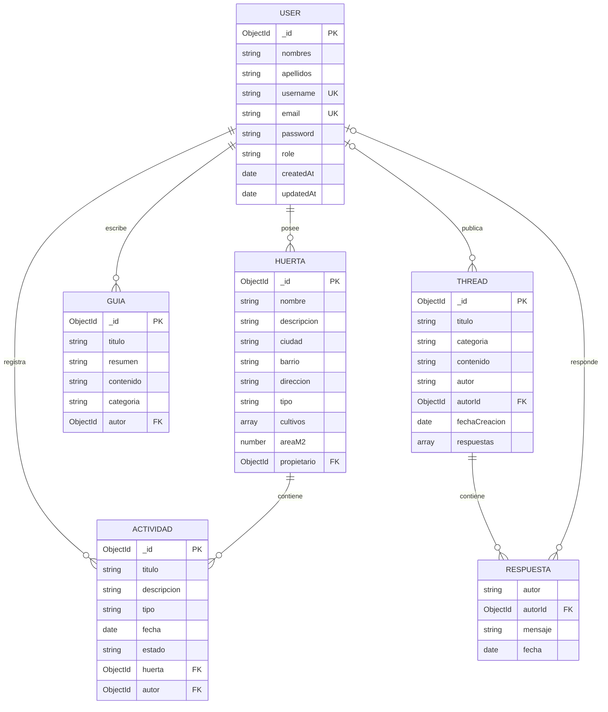

# Modelo general de EcoHuertos

Diagrama entidad-relación de la plataforma.

## Reglas del modelo

- Cada huerta pertenece a un usuario.
- Un usuario puede poseer varias huertas.
- Las contraseñas se almacenan mediante hash bcrypt.
- Los administradores gestionan las guías.
- Cada actividad pertenece a una huerta y tiene un autor.
- Las actividades pueden estar pendientes o completadas.
- Las respuestas se almacenan dentro de las publicaciones.
- Al eliminar una huerta se eliminan sus actividades.
- Al eliminar un usuario se eliminan sus huertas y las actividades correspondientes.

## Base de datos

MongoDB Atlas almacena la información mediante documentos.
Mongoose permite definir los modelos, validaciones y referencias.

El diagrama representa las relaciones lógicas del sistema.
Las respuestas del foro son documentos anidados.
