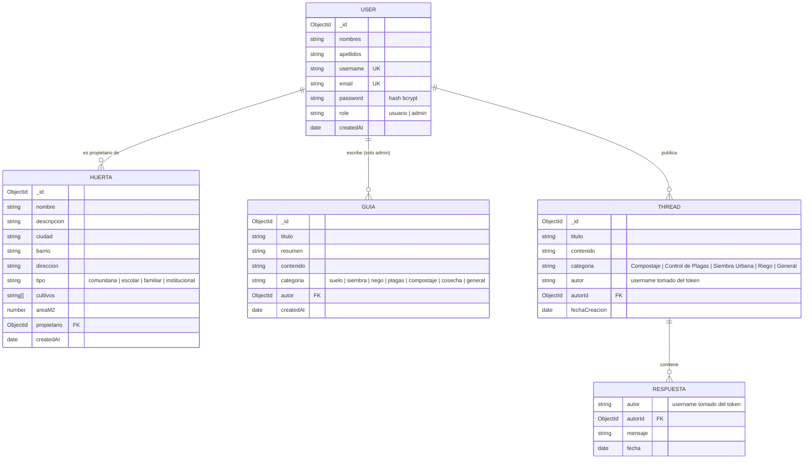

# Modelo general

Diagrama entidad-relación (se visualiza en GitHub gracias a Mermaid).

## Reglas del modelo
- Un usuario puede tener muchas huertas; cada huerta pertenece a un solo propietario.
- Al eliminar un usuario desde el panel admin se eliminan también sus huertas.
- Las respuestas del foro son subdocumentos embebidos dentro de su hilo (`THREAD.respuestas`).
- En el foro, el autor se toma siempre del token JWT, nunca del cuerpo de la petición (no se puede suplantar).
- La contraseña nunca se devuelve en las respuestas de la API.
